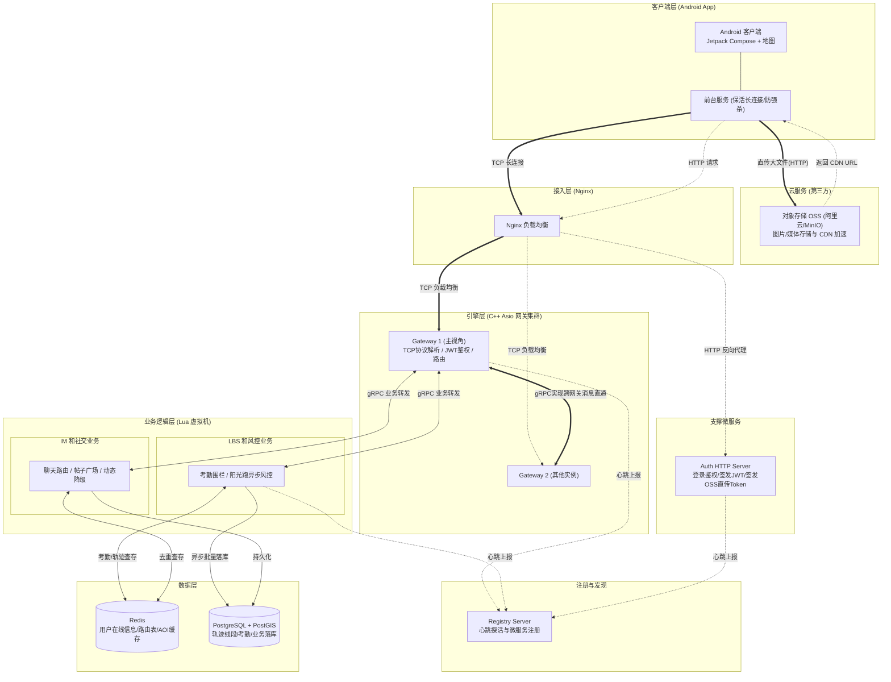
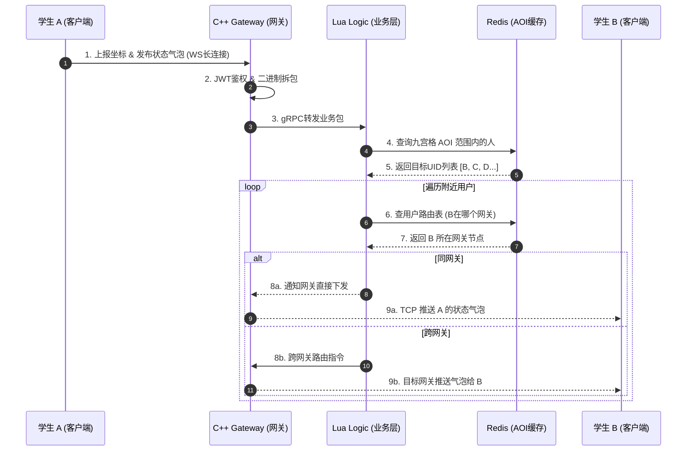
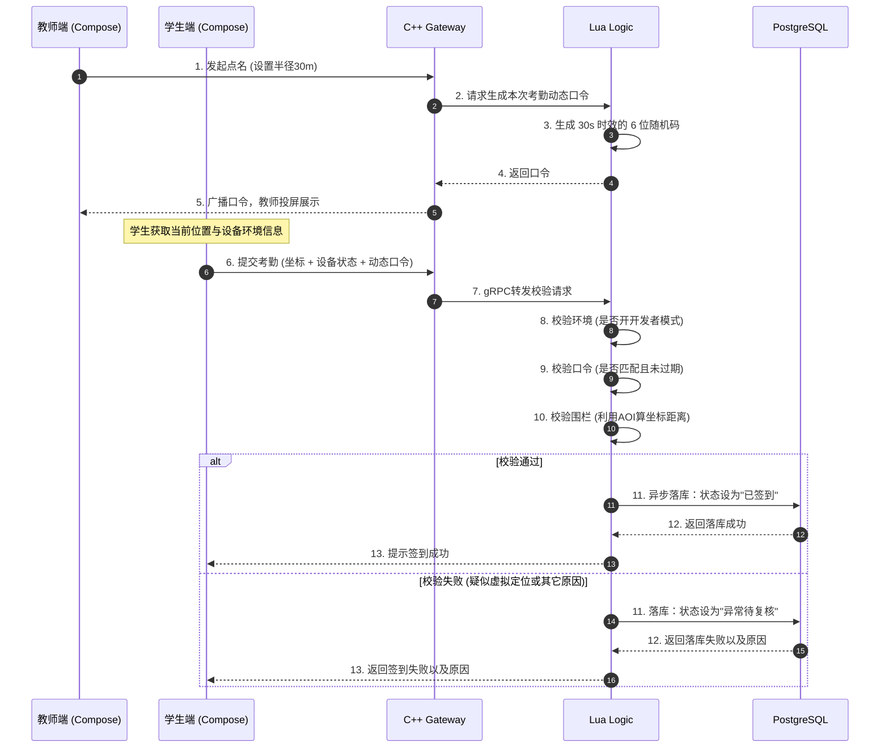
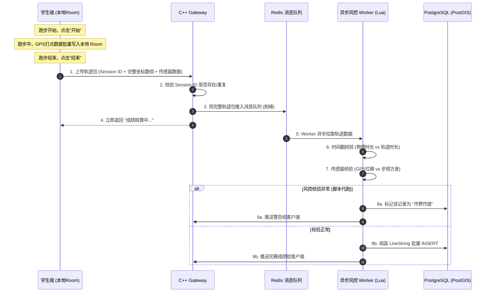
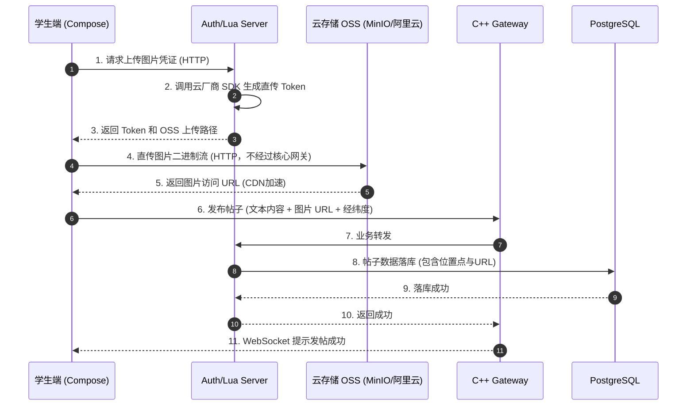

# 🎓 高并发 LBS 智慧校园系统 - 总体架构与技术方案

## 一、 课题名称

**《基于地理围栏与即时通讯的智慧校园系统设计与实现》**

## 二、 核心功能模块划分

系统按业务划分为 **五大核心模块**：

### 1. 智慧教务与考勤闭环（LBS核心）

- **地理围栏考勤**：教师端一键发起，服务端基于 AOI 算法划定电子围栏，校验学生位置，防止逃课。
    
- **防作弊机制**：结合客户端环境校验（防开发者模式）、动态口令校验（防代签），以及异常轨迹风控。
    
- **请假与复核**：支持学生线上请假，教师端人工复核异常考勤（销假）。
    

### 2. 校园阳光跑（运动风控）

- **离线轨迹记录**：客户端本地持久化记录，聚合后批量上传，极低功耗。
    
- **异步防代跑**：利用服务端绝对时间戳、唯一轨迹 ID、传感器特征（计步/加速度）进行多维度校验，封杀脚本伪造。
    

### 3. LBS 动态社交圈（高并发互动）

- **地图找搭子**：基于 AOI 九宫格算法，实时寻找周围 50 米内的“饭搭子/球搭子”。
    
- **动态广场（帖子）**：异步分享校园生活，支持“只看附近 500 米”的帖子过滤。
    
- **幽灵隐身（隐私保护）**：支持细粒度隐私屏蔽，在校验广播前剔除特定用户，保护社交隐私。
    

### 4. 运营与活动展示（高并发读）

- **开屏活动页**：展示校园重大活动，通过 Redis 缓存与 Lua 开关热更新，抗住瞬时高并发读。
    
- **隐形水印**：UI 层覆盖轻量级动态水印，防截图溯源。
    

### 5. 实时通信（IM）

- **高可靠私聊**：基于 C++ 长连接底座，支持点对点可靠通信（ACK/重传/幂等去重）。
    
- **离线消息**：结合前台服务保活与 数据库持久化，确保消息不丢失。

---

## 三、 核心架构/技术选型

### ⚖️ 1. 架构选择：按业务拆分 vs 按层级拆分

#### 1.1 按业务拆分

- **✅ 优点**：

    - **业务边界清晰**：每个服务对应一个独立的业务线（类似 DDD 领域驱动设计）。
        
    - **内聚性高**：同一个业务的网络收发和业务处理写在一起（如 ChatServer 内部直接用内存函数调用），**零网络延迟**。
        
    - **适合小型项目**：开发部署简单，不需要复杂的 RPC 调用链路。
        
- **❌ 缺点**：
    
    - **I/O 与业务耦合（致命伤）**：如果某个业务（比如查历史记录）卡了 50ms，整个网络线程池都会被卡死，导致在线用防护的体验变差。
        
    - **扩容不精准**：如果带宽不够，你要给 `ChatServer` 扩容，但它其实 CPU 很闲；如果算力不够，扩容机器又浪费了带宽。
        
    - **无法做到极致的高并发**：面对海量长连接，业务一旦崩溃就会引发雪崩。

#### 1.2 按层级拆分

- **✅ 优点**：
    
    - **故障隔离与防雪崩**：无论 `Logic` 节点里的 Lua 脚本死循环或 MySQL 慢查询卡多久，`Gateway` 依然能稳定地维持心跳，绝不掉线。
        
    - **极致的弹性扩容**：按需分配资源。带宽不够，扩 `Gateway`；AOI 计算算不过来，扩 `Logic`。
        
    - **无损热更新**：Lua 逻辑改完直接 reload，网关无缝衔接。
        
- **❌ 缺点**：
    
    - **架构复杂度高**：多了网关到业务层的内网转发。
        
    - **增加了微小的延迟**：哪怕用 gRPC 或 Redis Pub/Sub，也会多 0.1ms - 0.5ms 的序列化和网络开销。

#### 1.3 最终架构选型

结合了两个架构拆分的优点：

- **纵向**上，分为接入层、业务层和支撑层。接入层是无状态的 C++ Gateway，负责抗住海量长连接和解析二进制协议；业务层下沉处理考勤和聊天等复杂逻辑。这样彻底隔离了网络 I/O 与业务逻辑，防止慢查询拖垮网关。

- **横向**上，在每一层内部做了微服务拆分。比如业务层拆分了 `LBS 节点` 和 `IM 节点`，支撑层拆分了 `Auth 鉴权` 和 `Resource 文件`。如果开学季办活动导致 LBS 流量暴增，我只需要单独横向扩容 LBS 节点，完全不影响底层的聊天系统。
    

### 💾 2. 数据存储选型

系统根据数据的“冷热程度”与“结构特征”，采用了 **“分层存储”** 策略：

|存储组件|选型|承担的职责与数据|选型理由与性能考量|
|---|---|---|---|
|**Redis**|缓存/内存数据库|**实时坐标、AOI索引、Session ID、活动页缓存、离线消息队列**|**解决极高并发读写**。Redis 的单线程模型与哈希结构能支撑海量位置状态覆盖；独立实例禁用 LRU，确保跑步缓冲数据不丢失。|
|**PostgreSQL**|关系型数据库|**历史轨迹（LineString）、帖子位置、用户与课程表**|**解决复杂空间查询与结构化存储**。借助 **PostGIS** 扩展，利用 GiST 空间索引，实现高效的范围搜索与几何线段存储。|
|**Room (SQLite)**|客户端本地 DB|**跑步轨迹离线持久化、聊天记录缓存**|**端云协同兜底**。防止网络抖动或 App 强杀导致数据丢失；批量写入解决高频 GPS 的磁盘 I/O 卡顿。|
|**对象存储**|本地文件系统/OSS|**用户头像、帖子图片、语音文件**|由独立的 `ResourceServer` 接管，剥离大文件 I/O，防止阻塞主业务长连接。|

## 四、 系统总体架构

系统采用 **“多端协同 + 多层解耦”** 的微服务架构。摒弃了传统的单体网络与业务耦合，将系统严格划分为：表现层、接入引擎层、业务逻辑层、数据与存储层。

1. **表现层（客户端）**：Android App（Jetpack Compose），多角色 UI 动态渲染，集成 OS 级地理围栏与前台服务保活。
    
2. **接入引擎层（C++）**：底层基于 `boost/asio`（Linux 底层为 `epoll`）的高并发网络网关。负责长连接维持、二进制协议解析、JWT 鉴权与消息路由，内置系统物理资源水位监控。
    
3. **业务逻辑层（Lua 虚拟机）**：承载 AOI 九宫格计算、考勤风控、阳光跑防作弊、动态限流降级等复杂业务。利用 Lua 沙盒实现业务热更新与故障隔离。（遇到突发流量或风控规则调整，直接热更新 Lua 脚本，无需重启 C++ 引擎，实现用户零掉线。）
    
4. **数据与存储层**：PostgreSQL（结合 PostGIS 处理几何轨迹与复杂空间查询）、Redis（实时坐标、AOI 索引、高频缓存）、云端对象存储 OSS（媒体资源）。

---

## 五、 核心功能模块深度拆解（含时序图）

### 1. 高并发通信与动态自适应降频（C++ 引擎）

- **长连接引擎**：基于自定义二进制协议防粘包，结合 AOI 邻格广播，实现“少发+发小”的带宽优化。
    
- **动态自适应降频**：C++ 引擎实时读取 Linux `CPU/内存/带宽` 水位。当负载逼近 80% 时，通过长连接下发指令，强制客户端降低 GPS 采集频率，实现弹性自我保护。
    

### 2. AOI 空间索引与多场景复用

- **底层算法**：手写“九宫格（Grid）”空间索引。相较于动态树形结构，九宫格在高频并发下无锁竞争、性能极稳。
    
- **一套索引，多处复用**：精准推送附近搭子气泡、筛选附近 500 米的帖子、以及底层隐私过滤（幽灵隐身）。
    

**📌 LBS 社交（状态气泡）与跨网关广播时序图：**

### 3. 智慧教务与异步风控引擎（LBS 核心）

- **课堂考勤**：基于地理围栏与动态口令，结合 Android 环境校验，实现秒级防代签。
    
- **阳光跑与防作弊**：采用“端侧离线聚合 + 服务端异步落库”。服务端通过双时间戳、传感器数据融合、轨迹平滑度分析，封杀脚本代跑。
    

**📌 防作弊考勤（动态口令）时序图：**

**📌 校园阳光跑（离线批量上传与异步风控）时序图：**

### 4. LBS 轻社交与高并发内容生态

- **异步动态广场**：点赞等高频写操作引入 **Redis 缓存 + 异步批量削峰**，保护数据库。
    
- **开屏活动页**：结合 Redis 缓存与 Lua 开关热更新，应对瞬时全校涌入的极端读请求。
    
- **安全防护**：UI 层覆写全屏隐形水印，防截图舆情溯源。
    

**📌 媒体发帖（客户端直传 OSS 流程）时序图：**

---

## 五、 预期成果与工程创新点总结

1. **架构解耦**：实现了“C++ 高并发引擎”与“Lua 热更新业务”的物理隔离，故障互不影响。
    
2. **极速空间计算**：手写 AOI 九宫格算法 + PostgreSQL PostGIS，完美支撑海量 LBS 互动。
    
3. **风控**：在阳光跑场景下，创新性引入“唯一 ID + 双时间戳 + 传感器校验 + 轨迹平滑度特征”四重防线。
    
4. **弹性伸缩**：基于物理资源水位的动态自适应降频机制，保障高并发下的系统可用性。
    
5. **动静分离**：彻底剥离大文件传输，采用云存储直传与 CDN 加速，让核心网关专注高并发信令。