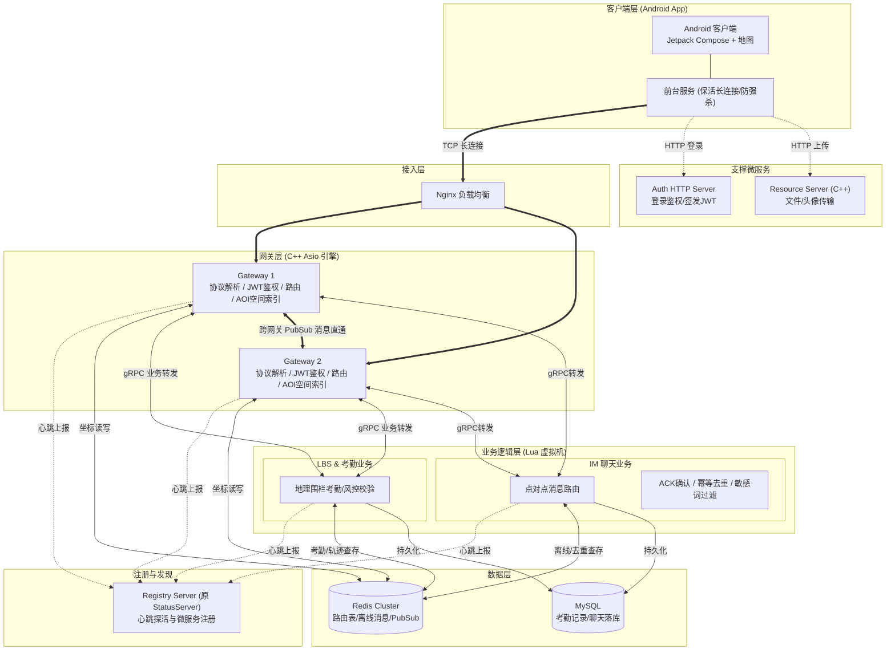

# 🎓毕业设计方案

## 一、 课题名称

**《基于地理围栏与即时通讯的智慧校园系统设计与实现》**  

## 二、 系统总体架构（分层解耦设计）

系统采用 **“三端协同 + 两层解耦”** 的微服务/伪分布式架构：

1. **表现层（客户端）**：Android App（Jetpack Compose），通过角色权限动态渲染教师/学生双端 UI。
    
2. **业务层（Lua 脚本）**：负责考勤规则、阳光跑校验、社交匹配、风控降级。利用 Lua 实现热更新，无需重启服务端即可修改业务参数。
    
3. **引擎层（C++）**：底层高并发引擎，基于 `boost/asio` 网络库（Linux 下底层为 `epoll`）处理海量 TCP 长连接，维护通信安全与 AOI 空间索引计算。
    
4. **存储层**：MySQL（用户/课程/考勤/好友关系），Redis（实时坐标、心跳状态、会话缓存）。

### ⚖️ 架构大对决：按业务拆分 vs 按层级拆分

#### 1. 按业务拆分（第一代 IM 架构）

- **核心逻辑**：根据业务模块划分微服务。比如 `AuthServer` 只管注册/登录/发凭证，`ChatServer` 既管聊天连接又管聊天逻辑又管鉴权。
    
- **✅ 优点**：
    
    - **业务边界清晰**：每个服务对应一个独立的业务线（类似 DDD 领域驱动设计）。
        
    - **内聚性高**：同一个业务的网络收发和业务处理写在一起（如 ChatServer 内部直接用内存函数调用），**零网络延迟**。
        
    - **适合中小企业**：开发部署简单，不需要复杂的 RPC 调用链路。
        
- **❌ 缺点**：
    
    - **I/O 与业务耦合（致命伤）**：在 `ChatServer` 里，如果某个业务（比如查历史记录）卡了 50ms，整个网络线程池都会被卡死，导致几万人掉线。
        
    - **扩容不精准**：如果带宽不够，你要给 `ChatServer` 扩容，但它其实 CPU 很闲；如果算力不够，扩容机器又浪费了带宽。
        
    - **无法做到极致的高并发**：面对海量长连接，业务一旦崩溃就会引发雪崩。
        

#### 2. 按层级拆分（现在的 LBS 架构）

- **核心逻辑**：剥离出最底层的“网络通讯”能力，独立成 `Gateway` 层；所有的业务逻辑全部下沉到 `Logic` 层。
    
- **✅ 优点**：
    
    - **故障隔离与防雪崩**：无论 `Logic` 节点里的 Lua 脚本死循环或 MySQL 慢查询卡多久，`Gateway` 依然能稳定地维持心跳，绝不掉线。
        
    - **极致的弹性扩容**：按需分配资源。带宽不够，扩 `Gateway`；业务计算算不过来，扩 `Logic`。
        
    - **无损热更新**：Lua 逻辑改完直接 reload，网关无缝衔接。
        
- **❌ 缺点**：
    
    - **架构复杂度高**：多了网关到业务层的内网转发。
        
    - **增加了微小的延迟**：哪怕用 gRPC 或 Redis Pub/Sub，也会多 0.1ms - 0.5ms 的序列化和网络开销。

### 为什么引入Lua作为业务层？

> 引入 Lua 作为业务层，主要出于三个考量：

1. **热更新能力**：业务规则（比如考勤距离、敏感词过滤）经常变动。Lua 脚本支持动态加载，无需重启 C++ 网关，保证了数万用户长连接的不间断。
    
2. **安全与隔离**：C++ 发生内存越界会导致整个服务宕机；而 Lua 运行在沙盒虚拟机中，即使 Lua 脚本崩溃，C++ 宿主也能捕获异常并快速重启虚拟机，保证了底层网络引擎的绝对稳定。
    
3. **开发效率**：C++ 负责处理高并发的 I/O 收发（重活）；Lua 负责处理轻量级的业务胶水（轻活）。这种架构不仅被我的 LBS 系统验证了，也是目前业界主流游戏引擎（如王者荣耀、原神）的标配。

---

## 三、 核心功能模块拆解

### 1. 高并发通信与安全底座（C++ 引擎）

- **长连接网关**：使用 `boost/asio` 网络库（Linux 下底层为 `epoll`），基于自定义二进制协议（长度前缀 + 消息类型 / 序列号 / ACK / 心跳）防止粘包/拆包，相比 JSON 显著压缩单条消息体积，叠加 AOI 邻格广播形成"少发 + 发小"双层带宽优化。
    
- **状态维持**：实现 JWT 无状态鉴权、心跳保活检测、以及**单点登录互踢（异地登录强制下线）**。
    
- **离线推送**：结合 Android 的 `Foreground Service`（前台服务），在 App 退居后台时维持长连接，实现告警通知。
    

### 2. AOI 空间索引与地图渲染

- **服务端（C++）**：采用“九宫格（Grid）”AOI 算法，将校园地图划分为网格。当发生状态更新时，仅向相邻网格的用户广播，降低 80% 以上的无用带宽消耗。
    
- **客户端（Compose）**：
    
    - **聚合渲染**：根据地图缩放级别，对密集区域的 Marker 进行 Clustering（聚合）显示。
        
    - **搜索高亮**：输入用户名，地图视角平滑移动并对目标头像进行高亮聚焦，解决重叠问题。
        

### 3. 智慧教务与阳光跑（LBS 核心业务）

- **课堂考勤**：教师端一键下发考勤指令，配置动态地理围栏（Geofencing）。
    
- **阳光跑打卡**：结合 OS 级地理围栏和 GPS 轨迹，记录学生的跑步路线。
    
- **多维度风控引擎（Lua）**：
    
    - **环境校验**：客户端检测设备是否开启“开发者模式”或“USB调试”，拦截低级模拟器。
        
    - **物理轨迹校验**：服务端计算两次上报的位移速度（如 1 分钟内移动 3 公里即判定瞬移）；对阳光跑进行**配速校验**和轨迹连续性分析，防骑车代跑。
        
    - **防强杀拦截**：考勤中按返回键触发拦截弹窗；若发生强杀断网，触发服务端心跳超时告警。
        
- **复核闭环**：异常数据推送到教师端，教师手动判定“旷课/早退”或处理“请假/销假”。
    

### 4. LBS 轻社交与即时通讯

- **状态气泡**：学生可在地图当前坐标发布状态（如：求带饭、拼桌），通过 AOI 广播给附近同学。
    
- **搭子匹配**：基于 AOI 距离和用户标签（如：跑步、篮球），在 Lua 层进行业务匹配。
    
- **点对点私聊**：复用 C++ 通信底座，实现消息的 ACK 确认、去重、离线消息缓存。
    

---

## 四、 ⚠️ 待定实现与预留接口

以下是开发过程中可能遇到的变数：

1. **活体抓拍机制（预留）**
    
    - _现状_：目前采用“轨迹校验 + 环境校验”防作弊。
        
    - _待定_：如果答辩导师硬刚“完美静态虚拟定位怎么防”，则在 Compose 客户端预留调用系统相机的接口。签到时强制抓拍一张环境照片，压缩后 Base64 上传至服务端，推给老师复核。
        
2. **Web 教师端（待定/砍掉）**
    
    - _现状_：考虑到工作量，教师端暂定用 Compose 写进同一个 App 里（通过 JWT 角色控制）。
        
    - _待定_：如果后期时间充裕，可用 Python (FastAPI) + Streamlit 极速写一个 Web 投屏界面。
        
3. **AI 异常检测模型（待定）**
    
    - _现状_：目前使用物理速度阈值（如 `>30km/h`）判断异常。
        
    - _待定_：后期可尝试用 Python 的 `sklearn` 跑一个简单的 Isolation Forest，将模型参数写进 Lua 规则引擎，实现“无监督异常检测”（答辩大杀器，没时间就坚决不用）。
        
4. **防作弊检测的深度（待验证）**
    
    - _现状_：仅检测 Android 开发者模式和基本 Mock 拦截。
        
    - _待定_：是否引入 IP 网段校验（取决于是否能拿到学校教务系统 IP 规则，拿不到就放弃）。
        